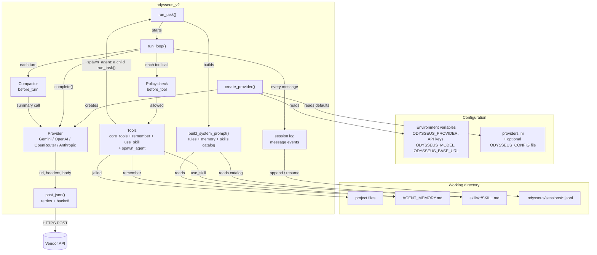
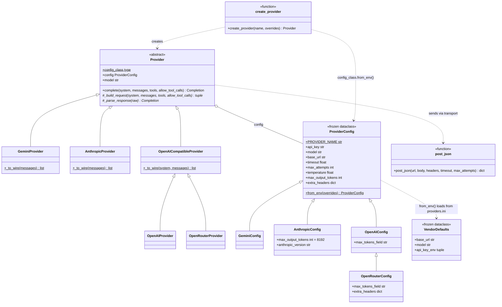
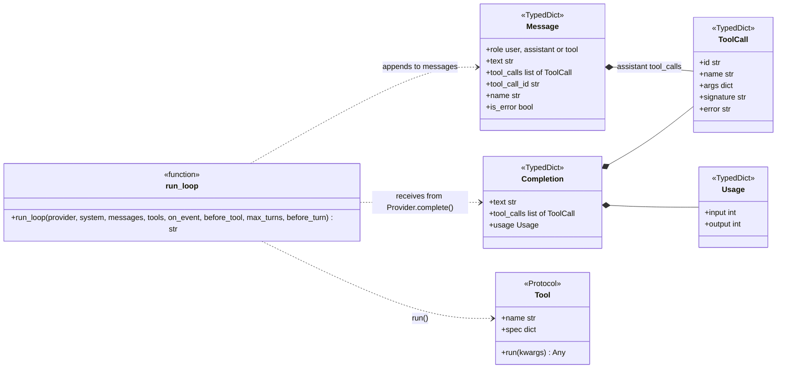

# Odysseus

**Odysseus** (`odysseus_v2`) is a small agent harness that works with any
model vendor. It runs the agent loop (call the model, run the tools it asks
for, repeat until it is done) and talks to Gemini, OpenAI, OpenRouter or
Anthropic through one provider interface. It uses only the Python standard
library.

## Origin

This project is based on the original Odysseus harness source code from
<https://odysseus-harness.vercel.app/>. That code was taken as the starting
point and modified to:

- **Give it a clearer structure:** an installable package (`pyproject.toml`,
  `src/` layout), with the agent loop, the providers, tests and demos each in
  their own place.
- **Improve the class layout:** an abstract `Provider` base class holds the
  shared logic (HTTP, retries, error handling), and each vendor is one
  subclass that only converts requests and responses to its own format.
- **Make it vendor-agnostic:** the loop talks to any provider through the same
  neutral message format; Gemini, OpenAI, OpenRouter and Anthropic are
  supported, and adding a vendor means one new module.
- **Move configuration out of the code:** vendor defaults (base URL, model,
  API-key variables) live in an ini file that can be overridden, and the
  provider must be chosen explicitly.
- **Add offline tests and documented demos.**

## Getting started

### 1. Clone the repo and go to this project

```bash
git clone https://github.com/kirankumar0710/ai-harness.git
cd ai-harness
cd odysseus          # this project's folder: pyproject.toml is here
```

**All the commands below are run from the `odysseus` folder**, not from the
`ai-harness` repo root. Running them from the root fails, for example with
`pip install -e .`: *does not appear to be a Python project*.

### 2. Create a virtual environment (recommended)

Requires Python 3.10 or newer.

```bash
python3 -m venv .venv
source .venv/bin/activate          # Windows: .venv\Scripts\activate
```

### 3. Install the package

```bash
cd odysseus          # skip if you are already in the odysseus folder
pip install -e .
```

From the `ai-harness` root, `pip install -e odysseus` does the same thing.

`-e` (editable) links the install to your checkout, so code changes take
effect without reinstalling. There are no third-party dependencies.

### 4. Check it works (offline, no API key needed)

```bash
python3 -m unittest discover tests
```

The run should end with `OK`.

### 5. Choose a provider

There is no default; you must pick one.

```bash
export ODYSSEUS_PROVIDER=anthropic     # or gemini / openai / openrouter
```

### 6. Export that provider's API key

| Provider     | Key variable                                  |
|--------------|-----------------------------------------------|
| `anthropic`  | `ANTHROPIC_API_KEY`                           |
| `gemini`     | `GEMINI_API_KEY` (or `GOOGLE_API_KEY`)        |
| `openai`     | `OPENAI_API_KEY`                              |
| `openrouter` | `OPENROUTER_API_KEY`                          |

```bash
export ANTHROPIC_API_KEY=...
```

`ODYSSEUS_API_KEY` works for any provider as a fallback. OpenAI has no
default model, so for `openai` also set one, e.g. `export ODYSSEUS_MODEL=...`.

### 7. Run a demo

```bash
python3 demos/dice/dice.py
```

Open [`demos/index.html`](demos/index.html) in a browser for the list of
demos, what each one shows, and a sample run with analysis.

Steps 1–4 are needed once. In a new terminal, activate the virtual
environment again and repeat steps 5–6 (or put the `export` lines in your
shell profile, e.g. `~/.zshrc`).

## Configuration

Settings are resolved in this order, highest first:

1. Arguments passed in code, e.g. `create_provider("gemini", model="...")`
2. The vendor's own key variable, e.g. `GEMINI_API_KEY`
3. `ODYSSEUS_API_KEY`, `ODYSSEUS_MODEL`, `ODYSSEUS_BASE_URL`
4. The vendor's section in an ini file

Each vendor's default base URL, model and key variable names live in
[`src/odysseus_v2/providers/providers.ini`](src/odysseus_v2/providers/providers.ini).
To change them without editing that file, create your own `.ini` with only
the keys you want to change and point `ODYSSEUS_CONFIG` at it:

```ini
# ~/my-odysseus.ini
[openai]
model = gpt-...
```

```bash
export ODYSSEUS_CONFIG=~/my-odysseus.ini
```

API keys are never stored in the ini files; they come from environment
variables only.

## Using it in code

```python
from odysseus_v2 import create_provider, run_loop

provider = create_provider()          # reads ODYSSEUS_PROVIDER and the key
messages = [{"role": "user", "text": "Roll 3 dice."}]
answer = run_loop(provider, "You are a helpful agent.", messages,
                  tools={"roll_dice": RollDice()})
```

A tool is any object with a `name`, a `spec` holding its JSON schema, and a
`run(**kwargs)` method; see [`demos/dice/dice.py`](demos/dice/dice.py) for a
complete example. `messages` is updated in place and holds the whole
conversation.

`run_task()` connects every part. With a session log, a run that dies can
be resumed where it stopped:

```python
from odysseus_v2 import create_provider, open_session, run_task

provider = create_provider()
path, messages = open_session("path/to/project", "fix tests", resume=True)
answer = run_task(provider, "path/to/project", "Fix the failing test.",
                  mode="safe", messages=messages, session=path,
                  subagent_depth=1)     # also offer spawn_agent
```

`resume=True` continues the newest log in `.odysseus/sessions/` if there is
one, and starts a new log otherwise.

Several independent tasks run in parallel with `run_fleet()`, each in its
own folder:

```python
from odysseus_v2 import Job, run_fleet

results = run_fleet(provider, [Job("api", "work/api", "Add a /health route"),
                               Job("docs", "work/docs", "Fix broken links")],
                    mode="safe", max_workers=2, sessions=True)
```

From the command line (`odysseus` once installed, or `python3 -m odysseus_v2`):

```bash
python3 -m odysseus_v2 -d path/to/project            # interactive, asks before acting
python3 -m odysseus_v2 -d path/to/project -p "Fix the failing test" --mode yolo
python3 -m odysseus_v2 -d path/to/project --resume   # continue the last session
```

Headless runs (`-p`) default to safe mode with nobody to approve, so writes and
commands are refused unless you pass `--mode yolo`.

## Project layout

```
odysseus
├── README.md                          this file
├── pyproject.toml                     packaging (pip install -e .)
├── src
│   └── odysseus_v2                    the package (import odysseus_v2)
│       ├── __init__.py                public API: create_provider, run_loop
│       ├── loop.py                    the agent loop
│       ├── tools.py                   @tool decorator, six core tools, path jail
│       ├── security.py                permission gate: deny rules, modes, approver
│       ├── context.py                 token budget and the compactor
│       ├── memory.py                  system prompt, AGENT_MEMORY.md memory, remember tool
│       ├── skills.py                  skills catalog and the use_skill tool
│       ├── session.py                 append-only session log: resume after a crash
│       ├── subagent.py                spawn_agent: a fresh agent for one sub-task
│       ├── harness.py                 run_task(): every part connected
│       ├── fleet.py                   run_fleet(): many run_task calls in parallel
│       ├── cli.py                     the command line (python3 -m odysseus_v2)
│       ├── __main__.py                makes python3 -m odysseus_v2 run cli.main
│       └── providers
│           ├── __init__.py            create_provider() and the vendor registry
│           ├── base.py                Provider interface, config, HTTP with retries
│           ├── providers.ini          per-vendor defaults (base URL, model, key vars)
│           ├── anthropic.py           Anthropic Messages API
│           ├── gemini.py              Google Gemini API
│           └── openai_compatible.py   OpenAI, OpenRouter and other compatible servers
├── demos
│   ├── index.html                     list of demos
│   ├── map.html                       the same parts in Claude Code, pi and Hermes
│   ├── record.py                      run a demo and save its full output to <demo>/output/
│   ├── run.sh                         run every demo, every mode; output to runs/ (git-ignored)
│   ├── dice                           one tool, two tasks: the loop end to end
│   │   ├── dice.py
│   │   ├── output/
│   │   └── dice_walkthrough.html
│   ├── gate                           six core tools through every permission mode
│   │   ├── gate.py
│   │   ├── output/
│   │   └── gate_walkthrough.html
│   ├── skills                         two skills, three tasks: loaded only when relevant
│   │   ├── skills.py
│   │   ├── output/
│   │   ├── skills_walkthrough.html
│   │   └── example_skills/
│   ├── memory                         one task twice: without and with AGENT_MEMORY.md
│   │   ├── memory.py
│   │   ├── output/
│   │   └── memory_walkthrough.html
│   ├── context                        one long task twice: without and with compaction
│   │   ├── context.py
│   │   ├── output/
│   │   └── context_walkthrough.html
│   ├── durability                     a killed process resumed from its log; a sub-agent
│   │   ├── durability.py
│   │   ├── output/
│   │   └── durability_walkthrough.html
│   └── fleet                          three agents build three projects in parallel
│       ├── fleet.py
│       ├── output/
│       └── fleet_walkthrough.html
└── tests
    ├── test_harness.py                offline tests (fake transport, no network)
    ├── test_tools_security.py         tool contracts, path jail, permission gate
    ├── test_context_memory_skills.py  compaction, memory, skills, run_task
    ├── test_session_subagent.py       session log, crash and resume, sub-agents
    └── test_fleet_cli.py              parallel jobs, the command line
```

## Architecture

Odysseus is a small set of parts around one loop. The provider hides
everything vendor-specific behind one method, `complete()`; everything else
(tools, the gate, context, memory, skills) works the same with every vendor.
Applications usually call `run_task()`, which connects them all.

| Part | Where | Job |
|---|---|---|
| **Harness** | `run_task()` in `harness.py` | connects every part below for one task: tools, system prompt, gate, compactor, session log, sub-agents, loop |
| **Factory** | `create_provider()` in `providers/__init__.py` | picks the vendor and builds its provider with a resolved config |
| **Agent loop** | `run_loop()` in `loop.py` | calls the model, runs the tools it asks for, repeats until it is done; reports a reply cut off at the output limit |
| **Provider** | one subclass of `Provider` per vendor | converts the neutral conversation to the vendor's format and back |
| **Transport** | `post_json()` in `providers/base.py` | sends the HTTPS request; retries rate limits, server and network errors |
| **Tools** | `core_tools()`, `@tool` in `tools.py` | read, write, edit, list, grep, bash; file paths jailed to the working directory; bash gets no secrets from the environment |
| **Gate** | `Policy.check` in `security.py` | before every tool call: deny rules, then the mode (read-only / safe / yolo), then the approver |
| **Compactor** | `Compactor` in `context.py` | before every model call: if the request would pass the budget (measured from the vendor's reported size), folds old turns into a summary; warns if the budget is too small to fold into |
| **Memory** | `memory.py` | builds the system prompt, including `AGENT_MEMORY.md`; the `remember` tool adds to it |
| **Skills** | `skills.py` | lists `skills/*/SKILL.md` in the prompt; the `use_skill` tool loads one when relevant |
| **Session log** | `session.py` | appends every message to `.odysseus/sessions/*.jsonl` as it happens; resuming replays it, cuts a torn last line and answers calls whose results were lost |
| **Sub-agents** | `subagent.py` | the `spawn_agent` tool runs a fresh `run_task()` on a self-contained brief, under the same policy, and returns only its report |
| **Fleet** | `run_fleet()` in `fleet.py` | runs independent jobs in parallel, one `run_task()` per folder; one job's failure is its result, not an exception |
| **Command line** | `cli.py` | interactive or headless (`-p`) sessions with a session log; `--resume` continues the last one |



**How the loop works.** Each turn, `run_loop()` sends the conversation to the
provider and appends the model's reply. If the reply asks for no tools, the
loop returns its text: the model decides when the work is done. Otherwise it
runs each requested tool and appends one result per call, then starts the
next turn. The rules it keeps:

- Every tool call gets exactly one result, even when it is blocked by the
  `before_tool` gate or fails.
- A failing tool never crashes the loop: the error becomes a result the
  model reads.
- `max_turns` is a hard stop. When it is reached, one last call is made with
  tools disabled, so the model reports what was done instead of stopping
  silently.
- A reply cut off at the model's output-token limit is never passed off as
  complete: the loop emits a `truncated` event and the returned answer ends
  with a warning.

Each demo's page in [`demos/`](demos/index.html) traces a concrete run
through these parts. [The map](demos/map.html) puts the same parts side by
side in Claude Code, pi and Hermes Agent.

## Class layout

### Providers and configuration

Each vendor has a provider class and a matching config class. The provider's
`config_class` names its config, which `create_provider()` uses to build it.
`create_provider()` and `run_loop()` are plain functions, not classes.



| Provider | Config | Notes |
|---|---|---|
| `GeminiProvider` | `GeminiConfig` | echoes reasoning signatures; generates call ids when Gemini sends none |
| `AnthropicProvider` | `AnthropicConfig` | `max_output_tokens` defaults to 8192 (Anthropic requires it) |
| `OpenAIProvider` | `OpenAIConfig` | no default model; sends `max_completion_tokens` |
| `OpenRouterProvider` | `OpenRouterConfig` | sends `max_tokens` and an `X-Title` header |

`#` marks internal methods that subclasses implement (`*` = abstract);
`$` marks class-level (static) members.

### Messages and tools

The loop and every provider exchange the same neutral types. They are plain
dicts (`TypedDict`), so a conversation can be saved as JSON and replayed on
any vendor.


